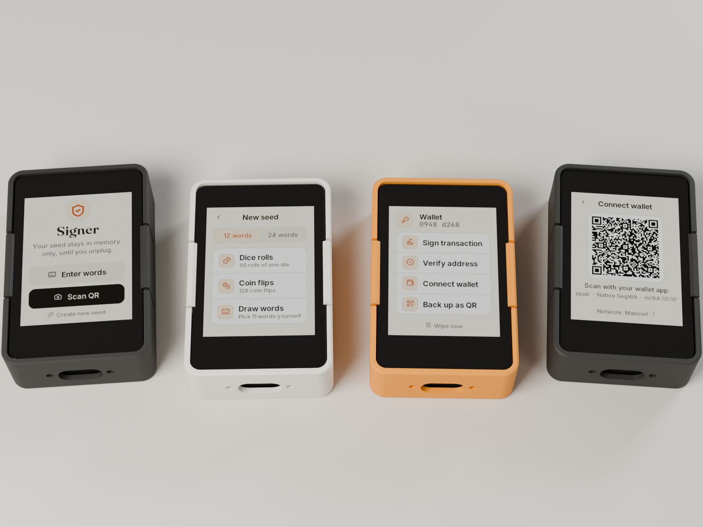
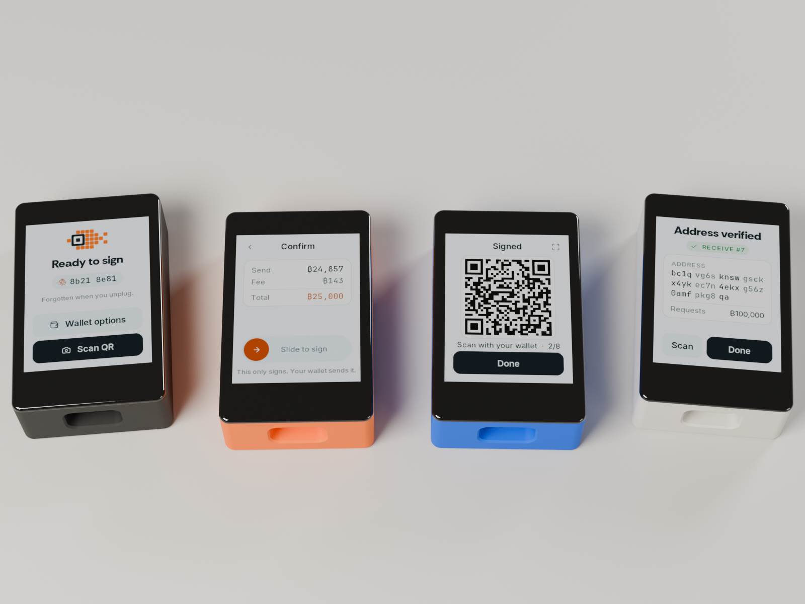

# Stateless Signer

A Bitcoin signer you build from an off-the-shelf board and a printed case.
Load your seed from a QR code, review and sign transactions, unplug to wipe.
Nothing is ever saved on the device, and the board has no Wi-Fi or Bluetooth
hardware: transactions go in and out through the camera and the screen.


<p>
  
  
  
</p>

Status: early, not for real funds. The firmware runs in a desktop simulator
with seed loading (QR or words), new seeds from dice, coins or drawn words, QR backups, transaction review
and signing, address verification, wallet pairing and BIP-85 child seeds; the board's camera driver is written but nothing has
been tested on real hardware or against Sparrow.

## Repository

| Folder | What's in it |
|---|---|
| [`firmware/`](firmware) | PlatformIO firmware (RP2350, LVGL, libwally-core), desktop simulator, tests |
| [`case/`](case) | Printed case in gcad: clip-in, STL and STEP exports |
| [`hardware/`](hardware) | Parts list and board notes |
| [`marketing/`](marketing) | Product renders made from the real case and firmware screens |

## How it works

1. Scan your seed QR (SeedQR, 12 or 24 words). The device shows its
   fingerprint so you can match it with your wallet. Or type your words
   backup. New seed makes a seed from dice rolls, coin flips or words you
   draw (the last word from coin flips), shows the words to write down and
   optionally walks you through a paper QR card, square by square. Any
   loaded seed can be backed up as a QR card the same way.
2. Connect wallet: show the xpub as a QR so Sparrow (or another wallet app)
   can track your balance and build transactions.
3. Sign transaction: scan the transaction QR from your wallet, check the
   amount, fee, change and every address, slide to sign, and scan the signed
   QR back into your wallet to broadcast it.
4. Verify address: scan a receive address to confirm it belongs to your seed.
5. Child seed: derive a BIP-85 child seed and back it up as words and a QR
   card, like a new seed.
6. Multisig: scan your wallet's descriptor QR in Sign transaction or Verify
   address, check it on the device, then sign that wallet's transactions as
   one of its cosigners (native segwit `wsh(sortedmulti)`).

## Quick start

```bash
cd firmware
pio test -e test                              # unit tests
uv run --with-requirements e2e/requirements.txt pytest e2e   # end-to-end, against the simulator
pio run -e sim && .pio/build/sim/program      # simulator window
pio run                                       # board firmware (UF2)
```

See [`firmware/README.md`](firmware/README.md) for flashing and the
simulator's test images, and [`case/README.md`](case/README.md) for printing.

## Roadmap

Tracked as [issues](https://github.com/reneaaron/stateless-signer/issues):
BIP-39 passphrase, address explorer and more.
