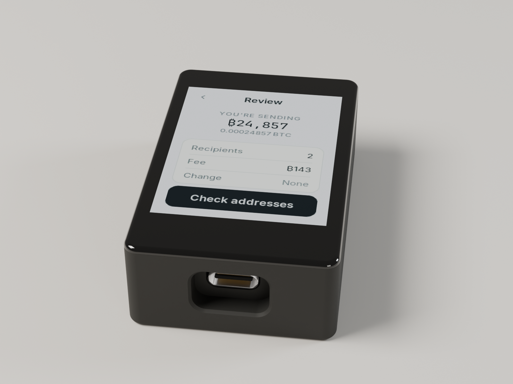

# Stateless Signer

A Bitcoin signer you build from an off-the-shelf board and a printed case.
Load your seed from a QR code, review and sign transactions, unplug to wipe.
Nothing is ever saved on the device, and the board has no Wi-Fi or Bluetooth
hardware: transactions go in and out through the camera and the screen.



Status: early, not for real funds. The firmware runs in a desktop simulator
with seed loading, new seeds from dice, coins or words, transaction review
and signing, address verification and wallet pairing; the board's camera driver isn't ported yet and nothing has
been tested on real hardware or against Sparrow.

## Repository

| Folder | What's in it |
|---|---|
| [`firmware/`](firmware) | PlatformIO firmware (RP2350, LVGL, uBitcoin), desktop simulator, tests |
| [`case/`](case) | Printed case in gcad: clip-in and screw variants, STL and STEP exports |
| [`hardware/`](hardware) | Parts list and board notes |
| [`marketing/`](marketing) | Product renders made from the real case and firmware screens |

## How it works

1. Scan your seed QR (SeedQR, 12 or 24 words). The device shows its
   fingerprint so you can match it with your wallet. Or create a new seed
   from dice rolls, coin flips or words you pick, copy it onto a paper
   SeedQR card square by square, and scan the card to check it.
2. Connect wallet: show the xpub as a QR so Sparrow (or another wallet app)
   can track your balance and build transactions.
3. Sign transaction: scan the transaction QR from your wallet, check the
   amount, fee, change and every address, slide to sign, and scan the signed
   QR back into your wallet to broadcast it.
4. Verify address: scan a receive address to confirm it belongs to your seed.

## Quick start

```bash
cd firmware
pio test -e test                              # unit tests
pio run -e sim && .pio/build/sim/program      # simulator window
pio run                                       # board firmware (UF2)
```

See [`firmware/README.md`](firmware/README.md) for flashing and the
simulator's test images, and [`case/README.md`](case/README.md) for printing.

## Roadmap

Tracked as [issues](https://github.com/reneaaron/stateless-signer/issues):
network setting, BIP-39 passphrase, address explorer, multisig and more.
