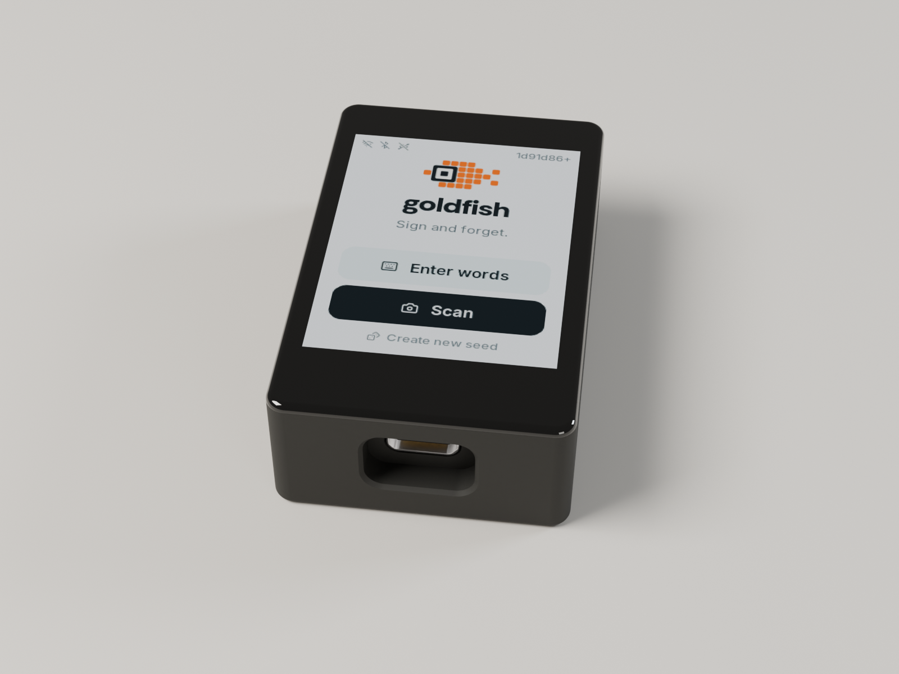
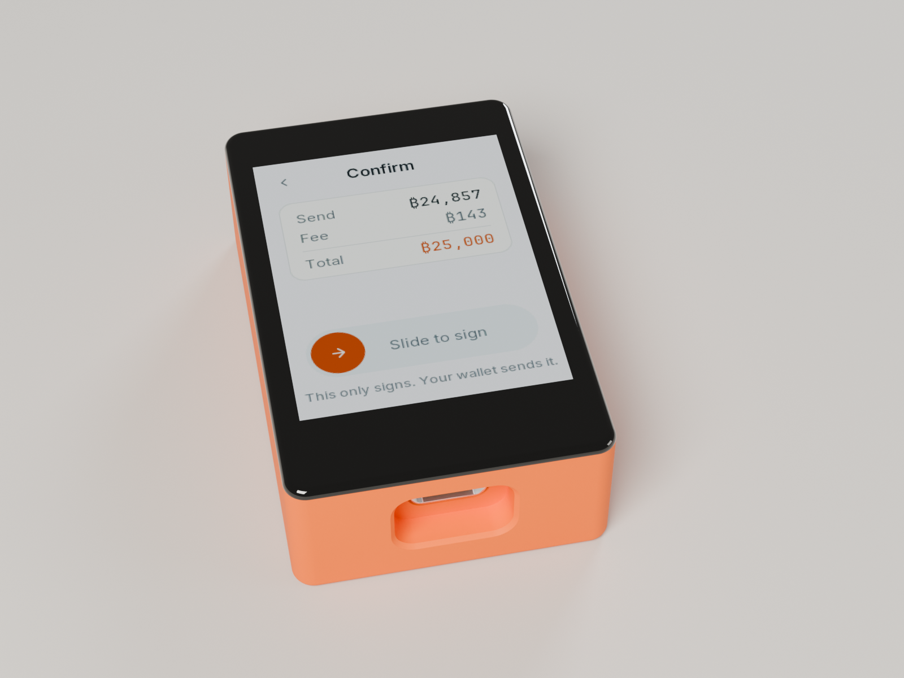
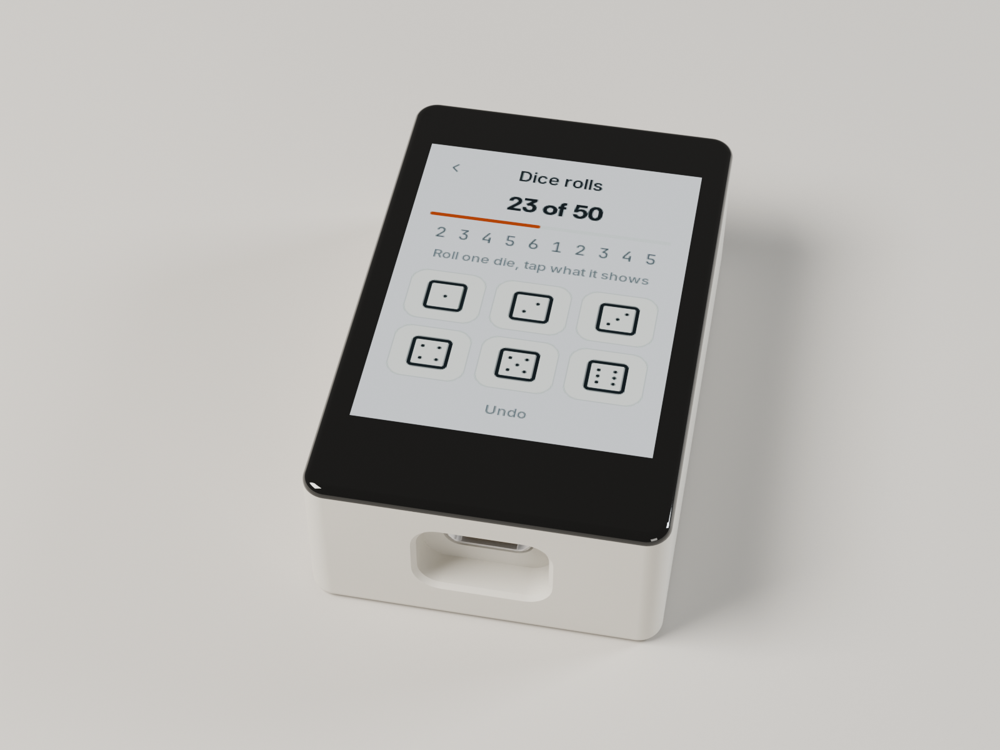
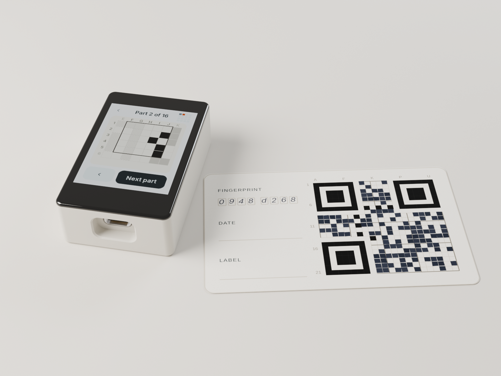

<p align="center"></p>

# Goldfish

**Sign and forget.** A Bitcoin signer you build from an off-the-shelf board and a printed case.
Load your seed from a QR code, review and sign transactions, unplug and it forgets.
Nothing is ever saved on the device, the board has no Wi-Fi or Bluetooth
hardware, and the firmware has no USB stack, so the USB cable only powers it:
transactions go in and out through the camera and the screen.

🌐 [Website](https://reneaaron.github.io/goldfish/)



<p>
  
  
  
</p>

Status: early, not for real funds. The firmware runs on the Waveshare board
(screen, touch and camera), in a desktop simulator, and in the browser
([`try/`](try), WebAssembly). It loads seeds from a
QR, typed words or a photo of a handwritten backup, makes new seeds from dice,
coins or drawn words, backs them up as QR cards, and reviews and signs
single-sig and multisig transactions. On a real board,
one 2-of-3 multisig wallet has been set up with Sparrow 2.5.2 on signet and a
transaction signed and broadcast, and single-sig transactions have been
signed with Sparrow, on mainnet too. The code hasn't been reviewed or audited.

## Repository

| Folder | What's in it |
|---|---|
| [`firmware/`](firmware) | PlatformIO firmware (RP2350, LVGL, libwally-core), desktop simulator, tests |
| [`case/`](case) | Printed case in gcad: glass on top, press-fit, no screws, STL and STEP exports |
| [`hardware/`](hardware) | Parts list and board notes |
| [`try/`](try) | Try the firmware in a browser: the page around its WebAssembly build |
| [`cards/`](cards) | Blank SeedQR and word cards for 12-word seeds, to print (open `index.html`, works offline) |
| [`metal/`](metal) | Guide to stamping a 12-word seed into stainless steel washers on a bolt |
| [`marketing/`](marketing) | Product renders made from the real case and firmware screens |

## How it works

1. Scan your seed QR (SeedQR, 12 or 24 words). The device shows its
   fingerprint so you can match it with your wallet. Or type your words
   backup. New seed makes a seed from dice rolls, coin flips or words you
   draw (the last word from coin flips), warning when the rolls or flips look
   made up (advice only), or from the device's own chip, camera, motion
   sensor and your scribble (words you can't check yourself; it warns you
   first), shows the words to write down and
   optionally walks you through a paper QR card, square by square. Any
   loaded seed can be backed up as a QR card the same way. Blank cards
   for 12-word seeds to print are in [`cards/`](cards).
2. Connect wallet (in Wallet options): show the public key as a QR, so
   Sparrow (or another wallet app) can set up a watch-only wallet that tracks
   your balance and builds transactions.
3. Sign transaction: Scan QR on the transaction from your wallet, check the
   amount, fee, change and every address, slide to sign, and scan the signed
   QR back into your wallet to broadcast it.
4. Verify address: Scan QR on a receive address to confirm it belongs to your
   seed. Signing and verifying share the one scanner.
5. Child seed: derive a BIP-85 child seed and back it up as words and a QR
   card, like a new seed.
6. Multisig: show your wallet's descriptor QR to Scan QR, check it on the
   device, then sign that wallet's transactions as
   one of its cosigners (native segwit `wsh(sortedmulti)`).

On any screen, drag down from the top edge to set the screen's brightness.

## Quick start

```bash
cd firmware
pio test -e test                              # unit tests
uv run --with-requirements e2e/requirements.txt pytest e2e   # end-to-end, against the simulator
pio run -e sim && .pio/build/sim/program      # simulator window
pio run                                       # board firmware (UF2)
```

See [`firmware/README.md`](firmware/README.md) for flashing and the
simulator's test images, and [`case/README.md`](case/README.md) for printing.

## Roadmap

Tracked as [issues](https://github.com/reneaaron/goldfish/issues):
address explorer and more.
