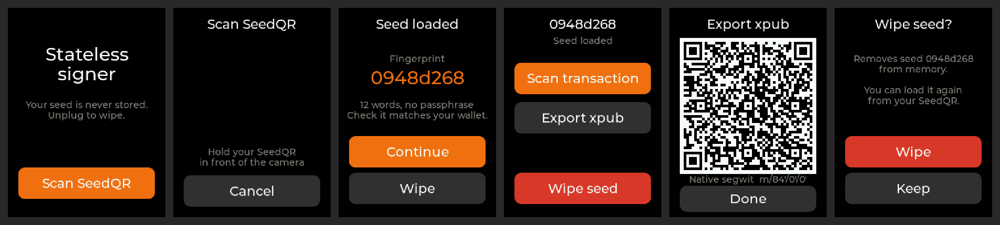

# RP2350 signer firmware

Firmware for a stateless, camera-based Bitcoin signer on the Waveshare
RP2350-Touch-LCD-2 (RP2350A, 16MB flash, 2" 240×320 touch screen, OV5640
camera connector). The board has no Wi-Fi or Bluetooth hardware.

Status: early. Seed loading from SeedQR and xpub export work in the
simulator; the camera driver and transaction signing don't exist yet. Not for
real funds.



## How it works

Seeds come in only as a SeedQR (Standard or Compact, 12 or 24 words), the
format SeedSigner uses. There is no manual word entry and no passphrase yet.
The seed lives in RAM only: "Wipe seed" or unplugging removes it.

1. Home: Scan SeedQR
2. Seed loaded: shows the fingerprint to check against your wallet
3. Seed menu: Scan transaction (PSBT detection only for now), Export xpub,
   Wipe seed
4. Export xpub: native segwit `[fingerprint/84h/0h/0h]zpub…`, the same static
   format SeedSigner exports, readable by Sparrow

## Stack

- PlatformIO with the Arduino core for RP2350 (earlephilhower/arduino-pico)
- LVGL 9.2 for the UI
- uBitcoin for BIP39/BIP32/PSBT
- quirc for QR decoding (vendored in `lib/quirc`)

## Build

```bash
pio run
```

The firmware ends up at `.pio/build/rp2350_touch_lcd_2/firmware.uf2`.

## Tests

```bash
pio test -e test
```

SeedQR decoding is checked against the vectors in SeedSigner's SeedQR spec;
key derivation against the BIP84 test vector (fingerprint `73c5da0a`).

## Desktop simulator

`src/app` also builds for Linux, in a 240×320 X11 window where the mouse acts
as the touch screen (a white dot shows the pointer). Needs `libx11-dev`.

```bash
pio run -e sim && .pio/build/sim/program
```

Camera: the simulator "sees" the image at `sim/camera.png` (or
`$SIM_CAMERA`), reloaded when the file changes. With the scan screen open:

```bash
cp sim/samples/vector4_standard_12word.png sim/camera.png
```

`sim/samples` holds SeedSigner's public test SeedQRs, plus a photo of a
stamped plate.

Screenshots of the whole flow, no window:

```bash
SIM_SHOTS=docs/screens .pio/build/sim/program
```

The simulator doesn't model the hardware: SPI timing, the PIO camera,
the 520KB RAM limit and secure boot only show up on the real board.

## Layout

- `src/app`: UI, SeedQR, wallet and QR scanning, shared by both targets
- `src/board`: display (SPI), touch (I2C), camera (stub) and `setup()`/`loop()`
- `src/sim`: X11 window, mouse input and the image-file camera
- `test`: unit tests (native)

## Flash

1. Hold BOOT on the board (bottom edge, right of USB-C seen from the back) and
   plug in USB-C. A drive called `RP2350` appears.
2. Copy `firmware.uf2` onto it. The board reboots into the firmware.

Or with the board already running PlatformIO firmware: `pio run -t upload`.

Serial log: `pio device monitor`.

## What to check on first boot

- The home screen appears with the right colours (if colours look inverted
  or red/blue swapped, adjust `0x21`/`0x36` in `src/board/display.cpp`).
- Buttons react where you touch. If touches are mirrored or swapped, fix the
  mapping in `src/board/touch.cpp` (marked TODO).
- The scan screen stays empty: the camera isn't ported yet.

## Pin map

See `include/board_pins.h`. Taken from Waveshare's demo code
(RP2350-Touch-LCD-2.zip on the Waveshare wiki), which also contains a camera
example (`C/02-CAM`, OV5640 over PIO) to port next.

## Next steps

- Camera: port Waveshare's PIO capture into `src/board/camera.cpp`
- Animated QR input (UR `crypto-psbt`, BBQr) for PSBTs
- PSBT review (recipients, change verification, fee) and hold-to-sign
- Signed PSBT output as animated UR
- Secure boot with picotool
