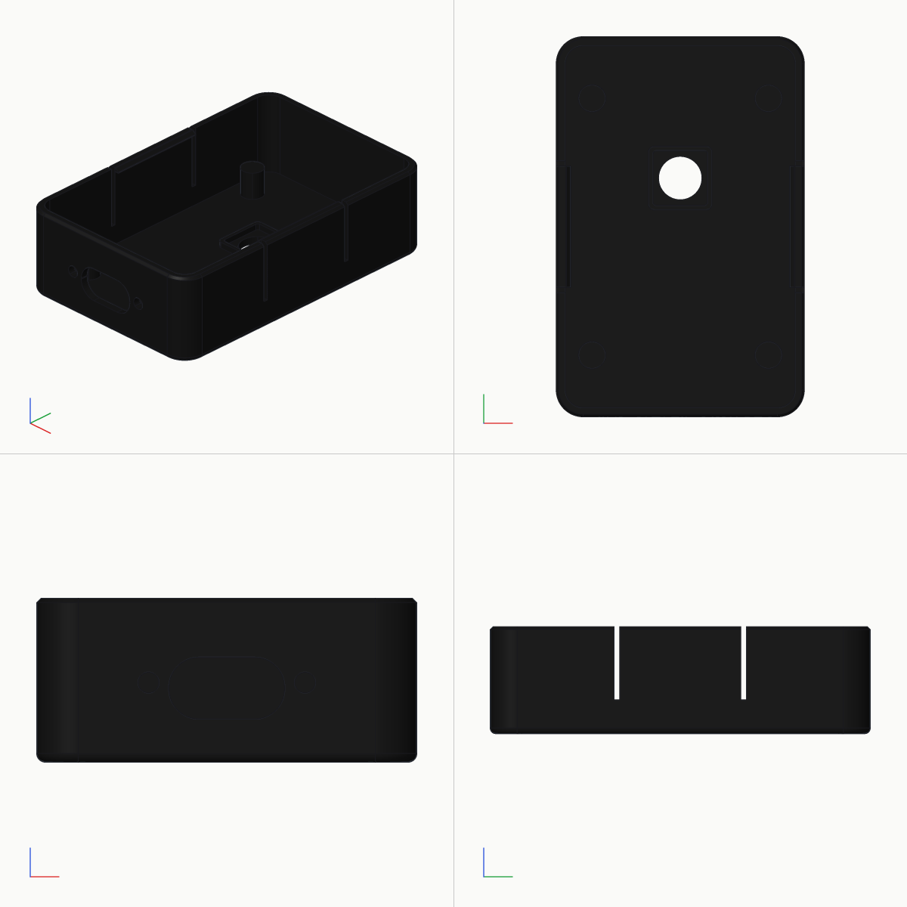

# Case

One-piece printed case for the Waveshare RP2350-Touch-LCD-2, modelled in
[gcad](https://github.com/v0l/gcad). Outside: 40.9 × 62.6 × 17.2 mm.



## Variants

`clip` in `parts/case.gcad` (and the assembly) picks how the board is held:

- `clip=1` (default): no screws. Two flexing tabs on each long wall catch the
  glass edge; the board rests on four posts behind it. Prints as
  `exports/case.stl`.
- `clip=0`: four M2x8 socket head screws from the back into the board's brass
  standoffs. Prints as `exports/case-screws.stl`.

## Files

- `parts/case.gcad`: the case
- `parts/board.gcad`: stand-in model of the board and camera, for fit checks
- `stateless-signer.gasm`: case + board (+ screws when `clip=0`), with an
  interference check
- `exports/`: STL for printing, STEP of the whole assembly
- `renders/`: engineering views from gcad

```bash
gcad check stateless-signer.gasm                 # fit check, clip version
gcad check stateless-signer.gasm --set clip=0    # screw version
gcad export parts/case.gcad exports/case.stl
gcad export parts/case.gcad exports/case-screws.stl --set clip=0
```

## Printing

Flat on its back, no supports. PLA works; the clip tabs flex about 1%.

## Estimated, check on the first print

Board outline, glass and mounting holes come from Waveshare's drawing. These
were measured off product photos and may need adjusting: camera module size
(`camw`, `lens`) and position (`camx`, `camy`), USB-C and button positions,
and whether the board's mounting holes are threaded M2 standoffs.
