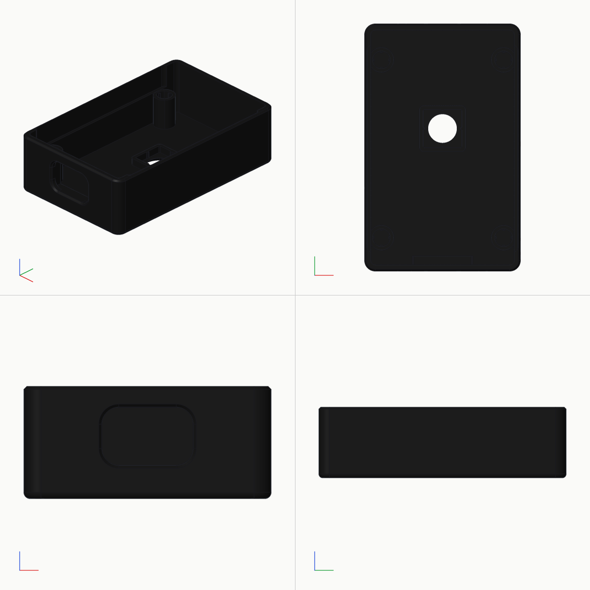

# Case

One-piece printed case for the Waveshare RP2350-Touch-LCD-2, modelled in
[gcad](https://github.com/v0l/gcad). Outside: 37.1 × 58.8 × 16.9 mm, 18 mm with the glass on.



No screws or other parts. The cover glass sits on top of the case, flush with
its outline; the LCD and PCB behind it drop into a pocket in the rim. The
board's four M2 standoffs press into sockets in the posts, where crush ribs
(`rw`) grip them.

## Files

- `parts/case.gcad`: the case
- `parts/board.gcad`: stand-in model of the board and camera, for fit checks
- `stateless-signer.gasm`: case + board, with an interference check
- `exports/`: STL for printing, STEP of the whole assembly
- `renders/`: engineering views from gcad

```bash
gcad check stateless-signer.gasm                 # fit check
gcad export parts/case.gcad exports/case.stl
```

## Printing

Flat on its back, no supports. PLA works. The long walls beside the LCD/PCB pocket are only 0.75 mm thick.
How hard the standoffs grip depends on the print; tune `rw` after a test fit.

## Where the dimensions come from

From Waveshare's [outline drawing](https://www.waveshare.com/img/devkit/RP2350-Touch-LCD-2/RP2350-Touch-LCD-2-details-size.jpg):
glass 37.1 × 58.8 R2.6 × 1.1, PCB 35 × 48.2, M2 standoffs on 29 × 42.2, 7.2 from
glass front to PCB back, 9.7 to the standoff ends, buttons 18.9 apart.

Measured off the photos in that drawing, good to about 0.3 mm:

- The LCD body behind the glass is about as long as the PCB (48 mm). Its
  width isn't given; the model assumes 35, the PCB's.
- The standoffs are round, 3.36 mm across (measured with calipers, `sock`).
- The standoffs end 8.9 mm behind the glass (measured; the drawing gives 8.6).
  Only the glass on the rim sets the height: the posts stop `lift` short of
  the PCB and the sockets run `deep` past the standoff ends.

- Header pins end 8.64 mm behind the PCB (standard 2.54 mm header). The case
  leaves 9.2 (`hdr`).
- The PCB sits 0.3 mm toward the USB end of the glass (`oy`).
- The USB-C socket ends about 3.7 mm inside the outer wall, so the plug's
  shell has to pass through the wall. A block behind the end wall turns the
  opening into a 13.6 × 8.6 mm tunnel up to the socket (`usbw`, `usbb`,
  `usbt`, `pd` long), about 1 mm round a measured 11.7 × 6.4 plug body.
  A first print at 12.6 × 6.4 only took the plug with force: FDM holes come
  out undersize.
- BOOT and RST stay closed in. Unplugging resets, and the firmware restarts
  into the bootloader from its home screen, so they're only needed for the
  first flash, with the board out of the case. A printed flexing button in
  the end wall was tried and snapped: printed on its back, it bent across
  the layer lines.

## Camera

OV5640 module, 21 mm type, from the module's outline drawing: base
8.5 × 8.5 ±0.2, lens barrel Ø6 standing 1.19 above it, 5.03 tall overall,
9 mm of free flex between the base and the contact strip.

The module is glued to the back of the board, on the TF card slot, so the
board sets where it is, not the case. Measured on an assembled board: centred
side to side (`camx`), its far edge 35.1 mm from the front of the USB-C
socket, and the front of the lens 15.05 mm behind the glass. Along the
length, a print with the camera 5.5 mm from the centre showed the lens 1 mm
toward the USB end, so `camy` is 4.5. That leaves the lens 1.35 mm above the case floor, looking through a 6.8 mm hole
(`lens`) countersunk to 9.6 mm on the outside so the floor stays out of the
picture. A square frame on the floor (`camw`, with crush ribs `rib`)
still surrounds the lens.

Not checked: that the module in the Waveshare -C bundle (flex marked
`DC-5M21-5640`) matches this drawing.
