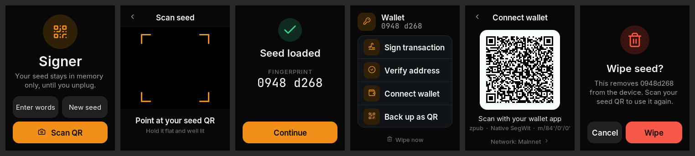
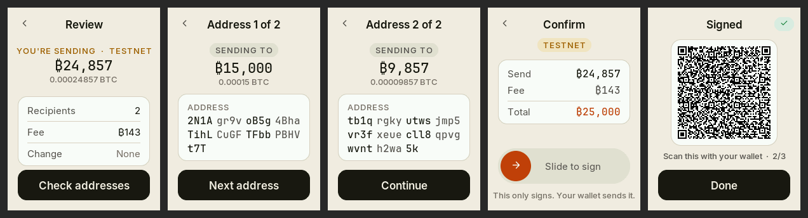
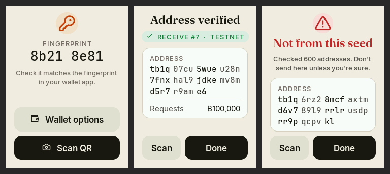
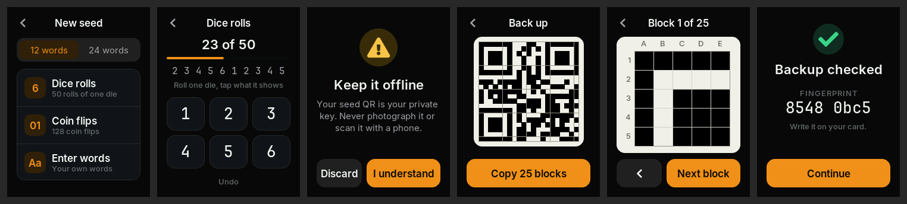
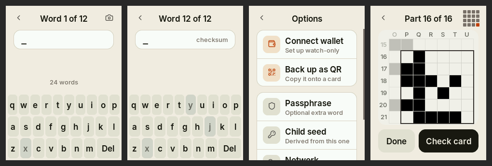
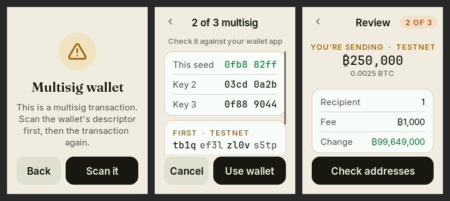

# RP2350 signer firmware

Firmware for a stateless, camera-based Bitcoin signer on the Waveshare
RP2350-Touch-LCD-2 (RP2350A, 16MB flash, 2" 240×320 touch screen, OV5640
camera connector). The board has no Wi-Fi or Bluetooth hardware.

Status: early. Seed loading, BIP-39 passphrases, new seeds with a SeedQR backup, xpub export and
PSBT review/signing (single-sig and multisig) work in the simulator. On the board, the camera reads seed, descriptor and animated PSBT QRs, and a
2-of-3 multisig with Sparrow 2.5.2 on signet was set up, signed and broadcast; single-sig signing
hasn't been tried there yet. Not for real funds.








## How it works

Seeds come in as a SeedQR (Standard or Compact, 12 or 24 words), the
format SeedSigner uses (the UI just calls it a seed QR), as typed BIP39
words, or are made on the device. A BIP-39 passphrase can be added after loading.
The seed lives in RAM only: Forget seed or unplugging removes it.

1. Home: Scan (a seed QR or written words), Enter words, or New seed. The top left corner shows Wi-Fi,
   Bluetooth and USB crossed out: the board has no radio, and the firmware has
   no USB stack, so USB-C is power only (until Restart into the bootloader, see Flash).
2. Wallet: the home screen once a seed is loaded, shaped like Home: the logo,
   "Ready to sign", and the fingerprint to check against your wallet app (with
   a chip for a passphrase or a multisig wallet). A fingerprint icon marks the
   fingerprint on every screen that shows one. Scan QR for everyday use, and
   Wallet options for the rest:
   Connect wallet and Back up as QR, then Passphrase, Child seed and Network,
   then Forget seed on its own; the list scrolls
3. Scan QR: one scanner for a transaction to sign, an address to verify, or a
   multisig descriptor; the device tells them apart by their format
4. Connect wallet (the Watch-only wallet screen): shows the native segwit xpub as
   `[fingerprint/84h/0h/0h]zpub…`, the same static format SeedSigner exports,
   readable by Sparrow, with the start and end of the key under the QR. Tapping
   the QR shows everything in it: fingerprint, path and the whole key in groups
   of four. Network in Wallet options switches it to testnet
   (`[fingerprint/84h/1h/0h]vpub…`, shown in amber), which also serves signet and
   Mutinynet. The choice is kept in RAM, so every boot starts on mainnet. Signing and
   Verify address don't use it: they read the network from the PSBT or the address.
   "For a multisig wallet" switches to this seed's key for a multisig wallet,
   `[fingerprint/48h/0h/0h/2h]Zpub…` (BIP-48, native segwit; `48h/1h/0h/2h` and
   `Vpub…` on testnet), to add as a cosigner in the wallet app. Also RAM only
5. Verify address: Scan QR on a receive address (plain or `bitcoin:` URI) from your
   wallet app; the device checks the first 500 receive and 100 change
   addresses of this seed and says which one it is, or that it isn't yours;
   the amount a URI asks for (`amount=`) is shown too, or flagged if it isn't valid
6. Sign transaction: Scan QR on a PSBT (animated UR `crypto-psbt`, or a single
   base64 frame), review the amount, fee and change, check each output's
   address, slide to sign, then show the signed PSBT as an animated UR: 64-byte
   fragments in alphanumeric mode at ECC low, so each frame is a 41-module
   QR at 4 px a module (about 0.5 mm) that a laptop webcam can read. After the
   plain fragments come fountain-coded mixes of them, as Sparrow and SeedSigner
   send, so a wallet that missed a frame doesn't wait a whole loop for it.
   In Sparrow, set the QR density to Low (in versions up to 2.2, the
   "Decrease Density" button; Sparrow remembers it): Medium and High codes are too dense
   for the camera's 240x180 picture, and their fragments (over 256 bytes)
   aren't accepted. A long press on the camera picture shows the scan speed:
   frames per second, QR codes decoded per second, and quirc's time per frame
   (average and slowest).
   A PSBT can be up to 8 KB, about 15 inputs of a 2-of-3 multisig or 10 of
   a 3-of-5 (fewer when the wallet app adds the full previous transactions);
   a bigger one says "Transaction too big".

Brightness: on any screen, drag down from the top edge for a panel with a
brightness slider (10 to 100%); tap below it or drag it back up to close it.
A screen with a QR code still dims to 30% of the setting (at least 10%) so a
webcam doesn't overexpose it. Like everything else it's kept in RAM only:
full brightness again after unplugging.

Screensaver: a minute untouched on Home or Wallet and the goldfish swims
about, blowing the odd bubble and now and then thinking out loud ("Where was
I?"), with the backlight at its lowest (10%), which also hides the fingerprint.
A tap brings the screen back at the set brightness and presses nothing.

Enter words restores from a words backup: type each word. It starts at 12
words; a 24-word backup taps "24 words" on the first word. The keyboard only offers letters that lead to a word and, on the last
word, only words with a valid checksum. The seed loads right away.

Experimental: Scan seed also reads a handwritten backup, on any paper (plain, ruled, a printed card; one or more
columns; numbered or not). A SeedQR is read as soon as it is in view. For written
words, fit the page in view and hold still: after about 2 seconds with no QR
finder pattern in view and at least 8 words found on the preview (checked at
most twice a second), the device
takes one picture and finds the words (`src/app/page_reader.cpp`: the paper's
brightness, the photo's tilt, ruled and margin lines erased, blobs of ink
grouped into words, a row number joined to its word, reading order by columns
then rows), takes a second picture twice as sharp while you hold still (about
a second) and cuts each word's strip from it, where the word really is in that
later frame: around each word it is slid against the first picture, up to 6
preview pixels each way, and the best match wins (a hand moves between
frames, and the camera's two sizes needn't line up exactly). Words found then
shows the first picture with each word boxed (amber: a gap where a word should
be) and how many there are, so a blurry, dark or badly framed picture is
retaken before the slow part; the camera is done by then. Read reads each strip
as a whole word (`src/app/word_reader.cpp`: a small int8 network, 138k weights, trained on synthetic strips by
`handwriting/train_words.py` and exported by `handwriting/export_words.py`;
see `handwriting/README.md`,
gives letter probabilities across the word; every BIP-39 word and its first 4
letters is scored by its best path through them, and the best is offered only
if it clearly beats the next).

Then Check words lists the words found, in order, with "?" where one couldn't
be read; such a word's screen still offers its best reading as a one-tap
"Best guess, if it matches" (in poor light the reader is often right but not
sure enough to fill it in itself). A word too faint to be found at all still gets its place: a column
whose rows skip one (or a shorter column next to longer ones) gets a "?" row
there, with that part of the photo as its picture, when the page has fewer
words than the backup. Tap a word to see its own picture from the photo and
change it, remove it (a heading, a passphrase line), or add a missing word
before it. The button at the bottom always names the next step (Fix word 7, Add
word 24) and becomes "Matches my backup" only once there are exactly 12 or 24
words with a valid checksum; nothing goes in without it. The last word is read
like the others, not forced to fit the checksum, since a checksum that doesn't
match is how a misread word further up shows; if it doesn't fit (or couldn't be
read) while all other words are known, its screen offers the word that does
fit, read again from its picture among only those. Scan seed has a "Written
words instead?" link for anyone who points the QR scanner at paper. On 384
words in 18 phone and web photos (demo seeds) at 1000 pixels: 65% read, 2
wrong, the rest left to fix; real text that isn't a seed word is sometimes read
as one. The simulator finds the words on the camera image file at up to 500
pixels and cuts them from it at up to 1000. The board finds them on what its
preview shows (the middle 240x180 of each frame; the rows above and below were
never on screen), then switches the camera to 480x640 and takes that view in
bands of rows (it can't hold a whole one), as few as fit in about
96 KB, keeping only each word's strip; the strips go where the first picture
was. On the board this is untested: the band capture, its timing and the
reading speed are unmeasured.

Passphrase (in Wallet options) opens a keyboard for a BIP-39 passphrase (the "25th word"):
letters, digits and all ASCII symbols, up to 64 characters, with a Show/Hide
switch. OK derives the key again (a few seconds on the board, like loading) and
returns to Wallet with the fingerprint of seed plus passphrase, to check
against the wallet app. An empty passphrase removes it. The
device keeps only the derived key, not the passphrase; both go with Forget seed
or unplugging. Signing, Verify address, Connect wallet and Child seed
then all use the passphrase wallet. Back up as QR still writes the seed alone:
the passphrase is never part of a backup. Characters outside ASCII and a
passphrase QR aren't supported.

New seed is a tool: it makes a 12-word seed and its backup, but
doesn't load it. To use the seed, load it like any other (Scan QR or Enter
words). The device has no RNG of any kind, not even in tests: every bit
comes from the user and can be re-checked offline.

- Dice: 50 rolls; coins: 128 flips (heads = 1). The input
  string is hashed with SHA256, same as SeedSigner and bitcoiner.guide/seed,
  so the result can be checked there.
- Draw words: e.g. from a box. Type the first 11 words, then flip a
  coin for each of the 7 free bits of the last word. The
  flips are the bits themselves, so the last word can be checked by hand.

Then an offline warning, the words 4 per page to write down, and an
optional QR card: a Compact SeedQR (21×21 for 12 words, 25×25 for 24)
shown whole, then copied one part (5×5 squares) at a time, labelled with column letters
and row numbers like the card's grid (21×21 splits 5+5+5+6, so no thin
edge parts). Each part shows one ring of its neighbours greyed, to line up
with what is already on the card; squares a card template pre-prints (the finder
squares, the timing lines, the fixed dark module, and the alignment square on
25×25) are hatched. The blank 12-word cards in [`cards/`](../cards) come with
them printed. Scanning the finished card checks it. The flow ends with the
fingerprint to write on the backup; leaving it wipes the seed.

Back up as QR runs the same card flow for whatever seed is loaded, scanned
or typed, e.g. to turn a words backup into a QR card.

Child seed derives a [BIP-85](https://github.com/bitcoin/bips/blob/master/bip-0085.mediawiki)
child of the loaded seed (BIP39, English, 12 words, child number 0 to
2147483647) and hands it out like a new seed: warning, words, optional QR card
and check, then its fingerprint. The same seed and number always give the same
child; leaving the flow wipes it.

Amounts follow [BIP177](https://github.com/bitcoin/bips/blob/master/bip-0177.mediawiki)
and [bitcoin.design](https://bitcoin.design/guide/designing-products/units-and-symbols/):
whole bitcoins with the ₿ symbol (`₿150,000,000`), with the legacy BTC value
(`1.5 BTC`) under each headline amount for checking against wallets that still
show BTC. A long amount shrinks, then moves under its label; it's never
truncated or drawn over other text.

Review follows SeedSigner's rules: every input must belong to the loaded seed,
change counts as change only if the seed re-derives that exact output script,
and an output that claims our fingerprint but doesn't verify blocks signing.
"Belongs" means the seed re-derives the input's script at every path the PSBT
gives for our fingerprint (BIP84 paths for single-sig); a multisig input's
witness script must also be the descriptor's. A transaction without outputs,
an input that is already finalized, a full previous transaction that isn't the
one spent or disagrees with the witness UTXO, and a redeem script (or a witness
script on a single-sig input) are refused as invalid. After signing, every
signature of ours is checked against the reviewed amounts and our own scripts,
and nothing is shown if one doesn't match.
Native segwit only, single-sig or multisig, mainnet or testnet (from the PSBT's
derivation paths, or the multisig descriptor's keys). BBQr input isn't supported yet.

Multisig is `wsh(sortedmulti(...))`, up to 15 keys, with the loaded seed as one
cosigner. The device needs the wallet's output descriptor, because a PSBT alone
can name any cosigner keys next to ours:

- Connect wallet, set to Multisig, shows the key to add to the wallet in the
  wallet app. The device only needs the finished wallet's descriptor
- Show the descriptor QR to Scan QR: as
  plain text, as a `crypto-output` UR (BCR-2020-010, sortedmulti with HD keys),
  or as text in a `bytes` UR. `/<0;1>/*`, `/{0,1}/*` and `/0/*` are all read as
  receive 0, change 1, and so is a `crypto-output` key with no children, the way
  Sparrow shows it (pick UR, not BBQr). A checksum, if there is one, must be right
- The seed must really be one of the keys: the key at the origin path the
  descriptor gives for our fingerprint has to be the xpub written there
- A screen then shows M of N, every key's fingerprint and the first receive
  address to check against the wallet app. Only "Use wallet" makes the device
  use it; leaving the screen drops it
- From then on the Sign scanner takes that wallet's transactions (inputs and
  change must be scripts the descriptor derives, not the PSBT's own witness
  scripts) and the Verify scanner its addresses. A multisig transaction
  without a confirmed descriptor is refused
- The device adds its one signature; other cosigners' signatures stay in the
  PSBT. It doesn't combine or finalize: the wallet app does
- The descriptor is kept in RAM only and belongs to the key it was checked
  with: it isn't used with another seed or another passphrase, and wiping the
  seed or unplugging drops it, so it is scanned again next time

Not supported: `multi` (unsorted), `sh(wsh(...))` and `sh(...)` multisig,
taproot, miniscript, keys without an origin, Specter's and Coldcard's wallet
file formats.

## Stack

- PlatformIO with the Arduino core for RP2350 (earlephilhower/arduino-pico)
- LVGL 9.2 for the UI
- libwally-core for BIP39/BIP32/PSBT, pinned by commit in `platformio.ini` and
  built without Elements from its single-file amalgamation (`lib/wally`)
- quirc for QR decoding (vendored in `lib/quirc`)
- Inter, Rethink Sans and JetBrains Mono, converted for LVGL (`src/app/fonts`, SIL OFL)

## Build

```bash
pio run
```

The firmware ends up at `.pio/build/rp2350_touch_lcd_2/firmware.uf2`.

The build is reproducible: the same commit gives a byte-identical
`firmware.uf2`, whatever the checkout path or home directory. The platform,
Arduino core, toolchain, LVGL and libwally are all pinned in `platformio.ini`,
and `-ffile-prefix-map` keeps the PlatformIO packages path out of the binary.
The toolchain archives come from URLs in the pinned platform, and PlatformIO
checks no hash for those; the release workflow checks them against
[`toolchain.sha256`](toolchain.sha256) before building.
Each release tag (`v0.1.0`) gets a GitHub release, built by
`.github/workflows/release.yml` on a clean runner: `firmware.uf2`, its
`SHA256SUMS`, and a build provenance attestation that ties the file to that
workflow and tag. Check a downloaded file either way:

```bash
gh attestation verify firmware.uf2 --repo reneaaron/goldfish \
  --signer-workflow reneaaron/goldfish/.github/workflows/release.yml --source-ref refs/tags/v0.1.0
```

Without `--signer-workflow` and `--source-ref` any workflow run in the repo,
on any branch, would pass.

```bash
git checkout v0.1.0 && pio run && sha256sum .pio/build/rp2350_touch_lcd_2/firmware.uf2
```

Build on a clean tree: a dirty tree adds `+` to the version and so changes the
file. Compare against the release's `SHA256SUMS`, not only the hash the web
flasher shows: that page and its file come from the same place. CI prints the
hash of each commit's build in the run summary.

## Tests

```bash
pio test -e test
```

- SeedQR decoding: the vectors in SeedSigner's SeedQR spec
- QR scanning: the pictures in `sim/samples`, in a frame the size of the board camera's (240x180)
- Key derivation: the BIP84 test vector (fingerprint `73c5da0a`, zpub, testnet vpub),
  the same seed's BIP-48 multisig keys (Zpub, testnet Vpub) worked out by embit,
  and the BIP39 vector with passphrase `TREZOR` (root key, fingerprint `b4e3f5ed`),
  removed again and wiped with the seed; with the passphrase, the zpub and vpub
  worked out by embit; a 24-word seed (`abandon` x23 `art`): fingerprint and
  zpub by embit
- BIP39: every 12- and 24-word vector in Trezor's `vectors.json` (16): the
  entropy shows the vector's words, typing the words gives the entropy back,
  and with passphrase `TREZOR` it loads the vector's root key
- UR: SeedSigner's 29-part `crypto-psbt` vector, plus an encode/decode round trip
  and a decode from the encoder's fountain parts alone or with every other fragment missing,
  parts whose header would overrun the decoder's buffer (sequence 0,
  more fragments than the message needs), and a part of a message past 8 KB
  reported as too big
- Multisig descriptor: SeedSigner's native segwit 2-of-3 test wallet, with
  addresses and a witness script worked out by embit; the three spellings of
  the chains, a `crypto-output` UR made with urtypes (also cut short at every
  byte) and one shown by Sparrow 2.5.2 (keys without children), bad checksum, unsupported forms, a seed that isn't a cosigner, our
  fingerprint on someone else's key, and a changed passphrase
- Multisig PSBT: that wallet's test input with change, a self-transfer and a
  payment; our signature checked against the transaction and against the hash
  embit signed; a cosigner's signature kept; no descriptor, a 3-of-3 of the
  same keys, and change that pays another script
- PSBT review: SeedSigner's single-sig testnet vector (₿25,000 in, ₿24,857 out,
  ₿143 fee), signing, wrong seed and garbage input; inputs refused for an input
  script that isn't our key's, a second unverified key path with our
  fingerprint, no outputs, a finalized input, a mismatched previous
  transaction, extra redeem or witness scripts, and a multisig witness script
  that isn't the descriptor's; and a bogus signature of ours already in the
  PSBT, which signing refuses to hand out
- Verify address: BIP84's three addresses (receive 0 and 1, change 0), URIs and their
  amounts, testnet, foreign addresses, and a different seed loaded afterwards;
  multisig receive and change addresses, with and without the descriptor
- Amounts: BIP177 and legacy BTC formatting from ₿0 to the 21M cap
- BIP-85: the spec's 12 and 24-word BIP39 vectors, child number bounds, and
  the child's fingerprint matching the same seed loaded
- Word reader: the integer network bit for bit against `handwriting/export_words.py`,
  log-probabilities and words read for synthetic strips, a ruled-out word never
  picked, a blank strip read as no word
- Page reader: a synthetic photo (`sim/samples/handwritten_page.png`, made by
  `handwriting/make_page.py`) of 24 numbered words in two offset columns on ruled
  paper, tilted: every word offered is right and in reading order, at least 20
  offered; the same page at board size (found on a 200-pixel-wide picture, cut
  from 100-row bands of one twice as large) still gives at least 20, where the
  small picture's own strips give about half; with the sharp picture moved 8
  pixels right and 6 up, the shift is found for every word and the reading
  recovers (uncorrected, about a third is read); at 30% brightness (a dim
  room) every word is still found and as many read; a blank page has no words

## Fuzzing

`fuzz/` fuzzes everything a scanned QR reaches (quirc, UR, SeedQR, addresses,
PSBT review and signing) with AddressSanitizer and UBSan, and `oracle/`
checks PSBT review and signatures against embit on random honest and attack
PSBTs. How to build and run them: [`fuzz/README.md`](fuzz/README.md).

## End-to-end tests

```bash
uv run --with-requirements e2e/requirements.txt pytest e2e
```

`e2e/` plays both the user and the wallet app against the simulator, with only
what they have: it reads the screen, touches it (buttons, keyboards, the sign
slider), holds QR pictures up to the camera and scans the QR codes the signer
shows. The wallet app is a small stand-in for Sparrow built on embit
(`e2e/hostwallet.py`), not Sparrow itself: it never sees the seed, makes
descriptors and PSBTs from the key it scans off Connect wallet, shows them as
single or animated UR QR codes, and checks every signature that comes back
before finalizing the transaction. Coins are made up; nothing is broadcast.

- Single-sig: a new seed from dice rolls, its words typed back in, the wallet
  linked from the xpub QR, a receive address verified, a transaction with
  change reviewed and signed; a 24-word seed typed in; SeedQR Standard and Compact; the QR card check;
  an animated PSBT joined mid-cycle (fountain parts only) both ways and a base64 frame;
  another seed's transaction, another wallet's address, and fake change;
  a passphrase typed on the keyboard giving the key and signatures embit
  derives from the same words and passphrase, and removed again
- Multisig: Connect wallet's four keys (single-sig and multisig, mainnet and
  testnet) against embit; a 2-of-3 around the linked multisig key, refused until its descriptor is
  scanned and confirmed, then signed and finalized with a cosigner; every
  spelling of the descriptor at both scanners; a 3-of-5 after a cosigner has
  signed; wallets the seed isn't in, a forged fingerprint, `multi`, a wrong
  checksum; change to another multisig; the descriptor gone after a wipe;
  a 15-input transaction through a camera that reads each frame twice and
  misses three in four; a 20-input one, past 8 KB, refused as too big
- Brightness: the panel opens from a drag at the top edge (also one that
  starts on the back button, which isn't pressed), not from one further down,
  and closes from a tap below it (which doesn't reach the screen under it) or
  a drag back up
- Written words: a handwritten page held still on Scan seed is read without a
  tap, and Retake waits for the view to change; a QR held still isn't

The simulator runs headless for this (`SIM_CONTROL=1`, commands on stdin, see
`src/sim/main.cpp`), on a clock that only moves when the test says so. A
failing test prints the signer's screen and saves it as `e2e/failure_*.png`.

For the board's camera, `e2e/qr_player.py --out <file>.html` writes a page that
plays what Sparrow would: the test SeedQR, then testnet PSBTs for that seed in
three sizes as animated UR at Sparrow's three densities, at its 200ms a frame.
Hold the board up to the screen and long-press the preview for the scan speed.

## Desktop simulator

`src/app` also builds for Linux, in a 240×320 X11 window where the mouse acts
as the touch screen (a white dot shows the pointer). Needs `libx11-dev`.

```bash
pio run -e sim && .pio/build/sim/program
```

Camera: the simulator "sees" the image at `sim/camera.png` (or
`$SIM_CAMERA`), reloaded when the file changes. With the scan screen open:

```bash
cp sim/samples/vector4_standard_12word.png sim/camera.png
```

`sim/samples` holds SeedSigner's public test SeedQRs, a photo of a stamped
plate, and `testseed_height_demise_*` / `testpsbt_height_demise_base64.png`, a
matching seed and testnet PSBT from SeedSigner's tests for trying the signing
flow. `mainpsbt_height_demise_base64.png` is the same transaction on mainnet
(made up by `sim/make_mainnet_psbt.py`); the screenshots use it.

Screenshots of the whole flow, no window:

```bash
SIM_SHOTS=docs/screens .pio/build/sim/program
```

The simulator doesn't model the hardware: SPI timing, the PIO camera,
the 520KB RAM limit and secure boot only show up on the real board.

## Browser simulator

The same `src/app`, compiled to WebAssembly with Emscripten, with `src/web`
in place of `src/sim`: the screen is a `<canvas>`, the pointer is the touch
screen, and the camera sees a picture the page hands it (one of a few
`sim/samples`: the test seed, a transaction for it, and a handwritten page,
`handwritten_page_demo.png`, that the firmware reads 24 of 24). The page is
[`try/index.html`](../try/index.html). Needs `emcc` (emsdk 4.0.10).

```bash
pio pkg install -e sim          # once: LVGL and libwally
make -C web -j                  # -> .pio/build/web
python3 -m http.server -d .pio/build/web
```

The `Website` workflow (`pages.yml`) builds it from `main` and publishes it at `/try/`.
It's a demo: a browser tab isn't stateless, and the page says not to use a real
seed there.

## Layout

- `src/app`: UI, SeedQR, wallet and QR scanning, shared by both targets
- `src/board`: display (SPI), touch (I2C), camera (OV5640, PIO) and `setup()`/`loop()`
- `src/sim`: X11 window, mouse input and the image-file camera
- `src/web`: canvas, pointer and page-fed camera for the browser simulator (`web/Makefile`)
- `test`: unit tests (native)

## Flash

1. Start the bootloader. A board already running this firmware: on Home, tap
   the version in the top right corner, then Restart (`UI_UPDATE`; Home only
   shows with no seed loaded). The first time, or when the firmware doesn't
   start: take the board out of the case, hold BOOT (bottom edge, right of
   USB-C seen from the back) and plug in USB-C. Either way a drive called
   `RP2350` appears.
2. Copy `firmware.uf2` onto it. The board reboots into the firmware.

[`flasher/index.html`](../flasher/index.html) does step 2 from Chrome or Edge
on a computer: it asks for the `RP2350` drive, refuses any other folder, and
writes the file there. The `Website` workflow publishes that page on GitHub
Pages together with the latest release's `firmware.uf2`, after checking it
against the release's `SHA256SUMS` and attestation, and the page shows the
file's version, commit and SHA-256. The page is untested on a
real board (copying the file onto the drive by hand works).

Updating is the same steps with a newer file. Nothing is stored on the board,
so there is nothing to migrate and an older version can be flashed back. The
home screen shows the running version in the top right corner: the tag for a
build of a tagged commit, otherwise the short commit hash, with a `+` when the
build had uncommitted changes (`version.py`). The bootloader takes any UF2:
there is no signature check.

The firmware is built without a USB stack, so the running device doesn't show
up on a computer: there is no serial log and `pio run -t upload` can't reset
it. Flashing always goes through the chip's built-in bootloader, started by
BOOT or by Restart on the Update firmware screen. That bootloader is in ROM and stays reachable over USB whatever
the firmware does, so power the device from a charger or power bank, not a
computer, when a seed is loaded.

## What to check on first boot

- The home screen appears with the right colours (if colours look inverted
  or red/blue swapped, adjust `0x21`/`0x36` in `src/board/display.cpp`).
- Buttons react where you touch. If touches are mirrored or swapped, fix the
  mapping in `src/board/touch.cpp` (marked TODO).
- The scan screen shows the camera image. If it stays black, the line under
  it says why: `Chip id 0x…, not 0x5640` (camera not found or not an OV5640)
  or `No image within 1s` (no pixel clock or sync). If the image is
  blurry on an autofocus module, tune `CAM_FOCUS` in `src/board/camera.cpp`.

## Pin map

See `include/board_pins.h`. Taken from Waveshare's demo code
(RP2350-Touch-LCD-2.zip on the Waveshare wiki), which also contains the camera
example (`C/02-CAM`, OV5640 over PIO) the camera driver is ported from.

## Next steps

- Camera: test on hardware, tune focus and orientation
- Test against Sparrow end to end (testnet)
- BBQr input
- Secure boot with picotool
